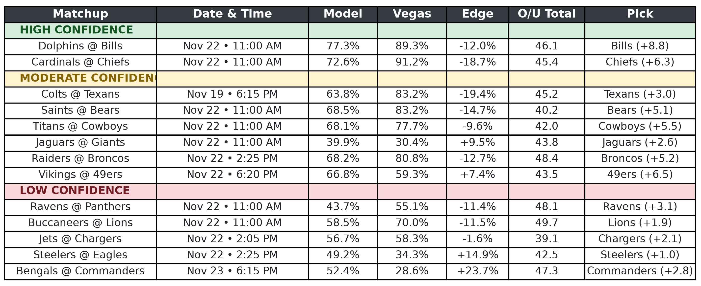

# 🏈 NFL Predictive Engine

An end-to-end machine learning pipeline that forecasts NFL game margins, total points, win probabilities, and Against-the-Spread (ATS) edges using leak-free rolling efficiency metrics (`nflreadpy` play-by-play EPA, CPOE, and box-score differentials) paired with variance-calibrated XGBoost regressors.

---

## 📊 Latest Weekly Slate Projections

> *Auto-generated dark-slate matchup board comparing pure-stats XGBoost score projections against consensus market spreads, totals, and moneylines.*



*(Tip: Keep `predictions/latest_predictions.png` updated each week—see [Auto-Syncing the Hero Image](#-auto-syncing-the-hero-image-on-github) below.)*

---

## ⚙️ How the Pipeline Works

1. **Leak-Free Feature Engineering (`02_feature_engineering.py`)**
   * Computes rolling team offensive and defensive efficiency metrics (EPA/play, CPOE, net yards per play, passing/rushing differentials, and opponent-adjusted efficiency) strictly from prior games.
2. **Variance-Calibrated XGBoost Training (`03_model_training.py`)**
   * Trains separate XGBoost regressors for **point differential** and **total game points**.
   * Derives an out-of-sample **Variance Scale Factor** from walk-forward validation folds to eliminate regression-to-the-mean compression, stretching raw margin predictions onto the true NFL point-spread scale.
3. **Weekly Slate Inference & Market Comparison (`07_predict_weekly_slate.py`)**
   * Generates pure-stats projected team scores (`away_projected_score` @ `home_projected_score`) independent of game-by-game betting odds.
   * Compares calibrated model lines against market spreads, totals, and moneylines to surface `ats_edge`, `total_edge`, and confidence tiers (`High`, `Moderate`, `Low`).
4. **Custom Dark-Slate Dashboard Export (`render_prediction_table.py`)**
   * Renders a 2-column dark-mode visual slate featuring normalized NFL team logos, win-probability split bars, and emerald model-edge highlights.

---

## 🚀 Quickstart & Usage

### 1. Environment Setup
```bash
git clone https://github.com/deandinh/nfl-predictive-engine.git
cd nfl-predictive-engine
python -m venv env
source env/bin/activate
pip install -r requirements.txt
```

*(Optional)* Create a `.env` file in the project root if pulling live US market lines:
```env
ODDS_API_KEY=your_the_odds_api_key
```

### 2. Run the Weekly Prediction & Render Pipeline
```bash
# 1. Train & serialize the variance-calibrated margin model bundle
python src/03_model_training.py

# 2. Generate weekly JSON predictions & market edge comparisons
python src/07_predict_weekly_slate.py

# 3. Render the 2-column dark-slate PNG dashboard
python src/render_prediction_table.py
```

---

## 🖼️ Auto-Syncing the Hero Image on GitHub

Because GitHub README markdown requires a static image path (whereas your weekly output saves to `predictions/week_11/nfl_predictions_week_11.png`), add a 2-line copy at the bottom of `src/render_prediction_table.py` so `predictions/latest_predictions.png` always reflects your newest run:

```python
import shutil
shutil.copy2(output_image_path, os.path.join(PREDICTIONS_BASE, 'latest_predictions.png'))
```

Every time you push your weekly `predictions/` folder to `main`, visitors opening your repository will immediately see the newest slate board at the top of the page.

---

## 📁 Repository Structure

```text
nfl-predictive-engine/
├── data/                        # Engineered rolling feature datasets
├── models/                      # Serialized XGBoost model bundles (.joblib)
├── predictions/
│   ├── latest_predictions.png   # Hero dashboard image displayed in README
│   └── week_<N>/                # Weekly JSON payloads & archived PNG boards
├── src/
│   ├── 02_feature_engineering.py
│   ├── 03_model_training.py
│   ├── 07_predict_weekly_slate.py
│   └── render_prediction_table.py
└── README.md
```

---

## ⚠️ Disclaimer

This project is built for statistical modeling, data visualization, and sports analytics research. Model projections are informational only and do not constitute financial or betting advice.