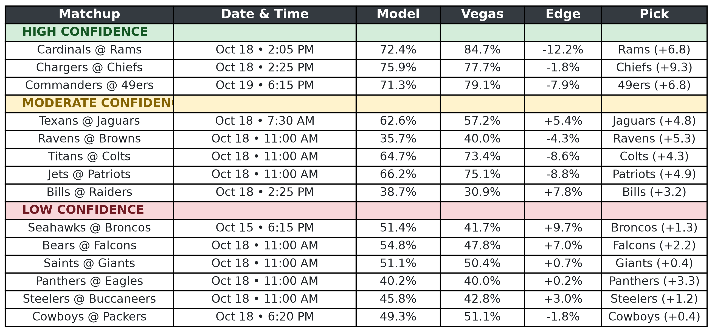

# NFL Predictive Engine: 2026 Season

## Week 5 Performance Review (Pre-2026 Data Integration)

Heading into Week 5, the model operated strictly on historical training data from the 2023–2025 seasons. For the Week 5 slate, the predictive engine posted an **8–6–1** straight-up record (57.1% accuracy, excluding the tie). 

**Key Takeaways from Week 5:**
* **Top-Tier Calibration:** The model went 1-0 on its single High-Confidence consensus pick, accurately backing the Jaguars (+7.0) to beat the Eagles.
* **Finding Value:** The engine successfully identified high-value inefficiencies in the betting market, successfully calling outright wins for underdogs like the Bengals (+13.5% edge over Vegas) and the Broncos (+8.6% edge).
* **Legacy Data Bias:** The model struggled with heavily changed rosters. It projected heavy edges for the Saints and Cardinals based on older baseline efficiencies, resulting in significant misses when both teams were blown out. 

## Mid-Season Data Recalibration: Why We Are Adding 2026 Data Now

Starting with Week 6 (today, October 18, 2026), we have officially updated the data ingestion pipeline to include the first five weeks of the current 2026 season into the XGBoost training set. 

**Why wait until Week 6?**
In predictive sports modeling, early-season data is incredibly noisy. Relying on 1 to 3 games of data can cause a model to overreact to fluke performances, weather anomalies, or early injuries. By waiting until five full weeks have concluded, the current-season metrics (EPA/play, CPOE, net yards per play) have reached a sufficient sample size to provide stable, actionable signals.

By feeding Weeks 1–5 of 2026 into the training data *now*, the model is recalibrating its weights to the current reality of the league—adjusting for new coaching schemes, rookie breakouts, and shifting defensive identities—while still maintaining the robust historical foundation of the 2023–2025 seasons. This eliminates the "legacy bias" that caused misses on teams like the Saints and Cardinals in Week 5.

## Week 6 Predictions

With the newly updated training weights applied, here is the model's output for today's Week 6 slate:

