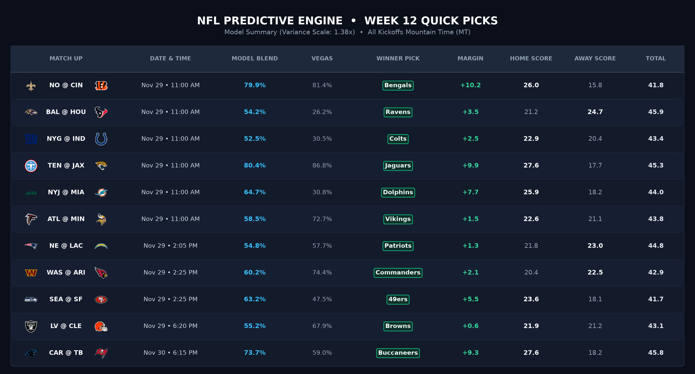

# 🏈 NFL Predictive Engine

An end-to-end machine learning pipeline that forecasts NFL game margins, total points, win probabilities, and Against-the-Spread (ATS) edges using leak-free rolling efficiency metrics (`nflreadpy` play-by-play EPA, CPOE, and box-score differentials) paired with variance-calibrated XGBoost regressors.

---

## 📊 Latest Weekly Slate Projections (Week 12)

> *Auto-generated dark-slate summary table featuring pure-stats XGBoost score projections, win probabilities, and projected margins.*



> 🎯 **Want full sportsbook lines & edge breakdowns?** View the [**Week 12 Detailed Matchup Cards (Spreads, Totals & Moneylines)**](predictions/week_12/nfl_predictions_week_12.png) for side-by-side BetMGM odds comparisons and model edge highlights.

---

## ⚙️ How the Pipeline Works

1. **Leak-Free Feature Engineering (`02_feature_engineering.py`)**
   * Computes rolling team offensive and defensive efficiency metrics (EPA/play, CPOE, net yards per play, passing/rushing differentials, and opponent-adjusted efficiency) strictly from prior games.
2. **Variance-Calibrated XGBoost Training (`03_model_training.py`)**
   * Trains separate XGBoost regressors for **point differential** and **total game points**.
   * Derives an out-of-sample **Variance Scale Factor** from walk-forward validation folds to eliminate regression-to-the-mean compression, stretching raw margin predictions onto the true NFL point-spread scale.
3. **Weekly Slate Inference & Market Comparison (`07_predict_weekly_slate.py`)**
   * Automatically skips games that have already kicked off at runtime so mid-week reruns only display upcoming matchups.
   * Generates pure-stats projected team scores (`away_projected_score` @ `home_projected_score`) and compares calibrated model lines against BetMGM spreads, totals, and moneylines to surface `ats_edge`, `total_edge`, and confidence tiers (`High`, `Moderate`, `Low`).
4. **Dual Dark-Slate Dashboard Export (`render_prediction_table.py`)**
   * Exports two dark-mode boards per week:
     * **Quick Picks Table (`nfl_predictions_week_<N>_simple.png`)**: Clean 9-column overview (`Match up`, `Date & Time`, `Model Blend`, `Vegas`, `Winner Pick`, `Margin`, `Home Score`, `Away Score`, `Total`).
     * **Detailed Matchup Cards (`nfl_predictions_week_<N>.png`)**: 2-column visual board with normalized NFL team logos, win-probability split bars, sportsbook odds tiles, and emerald model-edge highlights.

---

## 🚀 Quickstart & Usage

### 1. Environment Setup
```bash
git clone https://github.com/cdinh92/nfl-predictive-engine.git
cd nfl-predictive-engine
python -m venv env
source env/bin/activate
pip install -r requirements.txt
```

*(Optional)* Create a `.env` file in the project root if pulling live US market lines:
```env
ODDS_API_KEY=your_the_odds_api_key
```

### 2. Run the Weekly Prediction & Render Pipeline
```bash
# 1. Train & serialize the variance-calibrated margin model bundle
python src/03_model_training.py

# 2. Generate weekly JSON predictions & market edge comparisons
python src/07_predict_weekly_slate.py

# 3. Render both the simple summary table and detailed matchup cards
python src/render_prediction_table.py
```

---

## 📁 Repository Structure

```text
nfl-predictive-engine/
├── data/                                         # Engineered rolling feature datasets
├── models/                                       # Serialized XGBoost model bundles (.joblib)
├── predictions/
│   └── week_<N>/
│       ├── predictions_2026_week_<N>.json        # Weekly JSON payload & odds snapshot
│       ├── nfl_predictions_week_<N>_simple.png   # Clean 9-column summary table
│       └── nfl_predictions_week_<N>.png          # Detailed 2-column sportsbook card board
├── src/
│   ├── 02_feature_engineering.py
│   ├── 03_model_training.py
│   ├── 07_predict_weekly_slate.py
│   └── render_prediction_table.py
└── README.md
```

---

## ⚠️ Disclaimer

This project is built for statistical modeling, data visualization, and sports analytics research. Model projections are informational only and do not constitute financial or betting advice.