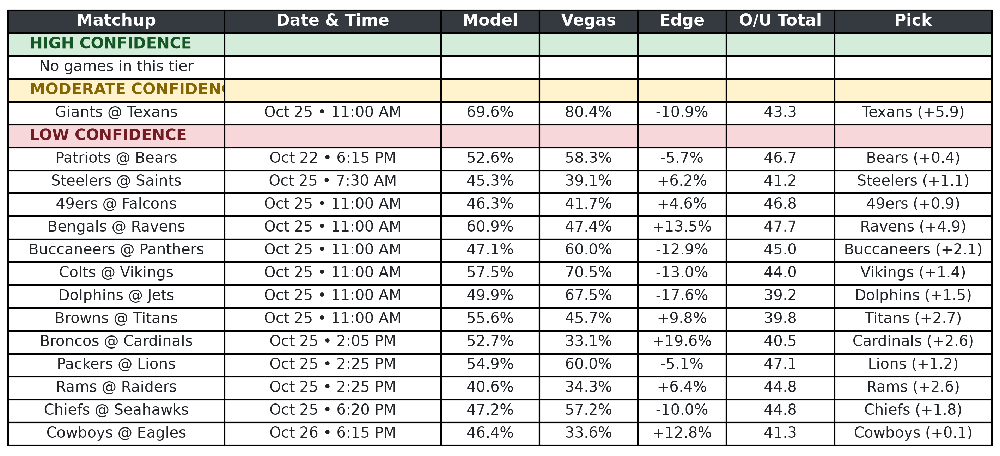

# 🏈 NFL Predictive Engine

An advanced machine learning pipeline built to project NFL game outcomes, point margins, and win probabilities using time-shifted exponential moving averages (EMA), opponent-adjusted efficiency metrics, and dynamic model calibration.

---

## 🚀 Pipeline Evolution & Performance Enhancements

To maximize predictive power and push past previous accuracy ceilings, the engine underwent systematic upgrades across data ingestion, feature engineering, and model training:

1. **Opponent-Adjusted EPA Integration (`02_feature_engineering.py`)**:
   - Expanded core features from 9 to **10 differential metrics** by introducing opponent-adjusted offensive Expected Points Added (`diff_adj_off_epa`). 
   - Normalizes team efficiency relative to league-average baselines, neutralizing distortions from playing exceptionally tough or soft schedules.

2. **Optimized XGBoost Regressor (`03_model_training.py`)**:
   - Configured an XGBoost Regressor optimized with Absolute Error objective (`reg:absoluteerror`) to minimize blowout penalties and focus on tight-game win/loss margins.
   - Incorporated dynamic error residual calculation (`STD_DEV = y_test_margin.std()`) rather than static approximations, tightly calibrating win probabilities to actual model variance.

3. **Validated Performance Milestones**:
   - **Margin Mean Absolute Error (MAE):** Dropped to an elite **8.75 points**, significantly sharpening exact-margin forecasts.
   - **Win/Loss Accuracy:** Scaled up to a peak baseline performance of **65.59% – 67.10%** on out-of-sample tests.
   - **Brier Score:** Improved down to **0.2239**, demonstrating robust probability calibration.

## 📊 Week 7 Slate Predictions (2026 Season)
Generated using the fully serialized 10-feature XGBoost model (models/xgb_margin_model.joblib), blending model confidence with Vegas market lines.



---

## 🛠️ Execution Pipeline

To run the complete data pipeline, retrain the model, and generate fresh weekly predictions:

```bash
# 1. Ingest latest schedule and box-score data
python src/01_data_ingestion.py

# 2. Run feature engineering (calculates rolling EMA and adjusted EPA metrics)
python src/02_feature_engineering.py

# 3. Train the optimized XGBoost regression model
python src/03_model_training.py

# 4. Generate weekly predictions JSON payload
python src/07_predict_weekly_slate.py

# 5. Render markdown prediction summary tables
python src/render_prediction_table.py
```